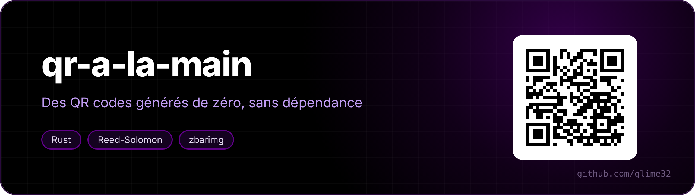
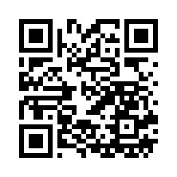

<p align="center"></p>

<p align="center"> </p>

A QR code generator in Rust, with no dependencies at all. I wanted to understand what's really inside those little squares, so everything is done by hand: Reed-Solomon codes, splitting into blocks, bit placement, masks.

<p align="center"><a href="README.fr.md">🇫🇷 Version française</a></p>



```
$ cargo build --release
$ ./target/release/qr salut
$ ./target/release/qr "https://github.com/glime32" --png lien.png
$ ./target/release/qr -e H --svg carte.svg "BEGIN:VCARD ..."
$ echo "texte long" | ./target/release/qr
```

The QR code is printed straight into the terminal (two modules per character with `▀ ▄ █`), or as PNG / SVG. Options: error correction level (`-e L|M|Q|H`), forced version and mask, `--boost` to take the best correction that fits in the same size, `--clair` for terminals with a white background.

`-d` shows how the symbol was built (the program talks French: `segment octets` = byte segment, `masque` = mask, `pénalités` = penalties):

```
$ ./target/release/qr -d "Commande 4211 : 0612345678"
version 2 (25×25 modules), correction M, masque 2
  segment octets            8 caractères  « Commande »
  segment alphanumérique    8 caractères  «  4211 :  »
  segment numérique        10 caractères  « 0612345678 »
  28 octets de données disponibles
  pénalités des masques : 0:529  1:499  2:487  3:583  4:676  5:699  6:589  7:666
```

## What happens

1. **Segments.** A QR code can encode digits (3 per 10 bits), uppercase alphanumerics (2 per 11 bits) or bytes. The text is split into segments by dynamic programming to minimise the total number of bits (switching modes costs a header, it's not always worth it). For non-ASCII text, an ECI header announces UTF-8; without it, some readers showed "ça" as ideograms.
2. **Version.** The smallest of the 40 sizes where the data fits, at the requested correction level.
3. **Error correction.** The bytes are spread into blocks, and each block gets Reed-Solomon bytes: the remainder of dividing the message by a generator polynomial, in the finite field GF(256). Then the blocks are interleaved, so that a stain on the symbol damages a little of every block rather than one whole block.
4. **Matrix.** The fixed patterns go in first (the three finder squares, the timing lines, the small alignment squares, the version information), then the data bits in a zigzag, two columns at a time, from right to left.
5. **Mask.** There are 8 ways to flip every other module, every third one... All of them are tried, and the one with the smallest penalty under the standard's 4 rules is kept (long solid runs, 2×2 squares, fake finder patterns, black/white imbalance).
6. **Format.** The correction level and the mask are written twice, protected by a BCH code.

## Tests

`cargo test` checks the finite field and Reed-Solomon on the classic "HELLO WORLD" 1-M example, the capacities, and the alignment pattern table.

The real checks go through an independent reader:

```
$ python3 verifier.py 300
453 / 453 relus à l'identique par zbarimg
```

The script generates 300 random texts (digits, uppercase, ASCII, accents and emoji, mixes), plus one symbol for each of the 40 versions and 4 correction levels, and checks that `zbarimg` reads back exactly the same text.

## Not done

Kanji mode, structured append over several symbols, micro QR. And no decoder: that's another project, much harder (you have to find the symbol in a photo).
